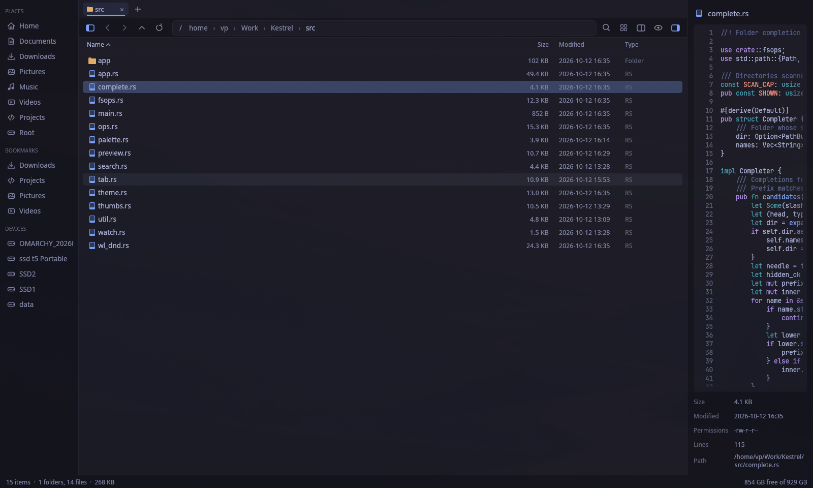

<p align="center">
  
</p>

<h1 align="center">Kestrel</h1>

<p align="center">
  A fast, keyboard-friendly file manager for <a href="https://omarchy.org">Omarchy</a>, inspired by <a href="https://filepilot.tech">File Pilot</a>.
</p>

<p align="center">
  
</p>

## Install

```sh
curl -fsSL https://raw.githubusercontent.com/vanyapoker/kestrel/master/install.sh | bash
```

Then open **Kestrel** from the app launcher (Super + Space) or run `kestrel` in a terminal.

The installer installs anything it needs to build (Rust, git), compiles Kestrel and
adds a launcher entry and icon. The first build takes a few minutes.

## Update

```sh
kestrel-update
```

This pulls the latest version and rebuilds it. Running the install command again does the same thing.

## Uninstall

```sh
bash ~/.local/share/kestrel/source/install.sh --uninstall
```

If you installed from your own clone, run `./install.sh --uninstall` there instead.

## Features

- **Fast.** All disk work runs in the background, so the window never freezes, even on huge folders or slow drives.
- **Folder sizes.** Every folder shows its real size, worked out live as you browse.
- **Preview panel.** See images, code with syntax highlighting, text, PDFs, videos, SVGs and audio details without opening anything.
- **Tabs and split view.** Work in several folders at once, and drag files between panes.
- **Find anything.** Type to filter the current folder, or press Ctrl+F to search all its subfolders.
- **Command palette.** Ctrl+P reaches every action.
- **Several views.** Switch between details, list and icon views, and zoom with Ctrl+scroll.
- **Safe file operations.** Copy and move run in the background with progress. Deleted files go to the trash, files are never overwritten (a copy with the same name gets a " (2)" suffix), and Ctrl+Z undoes renames, moves, copies and trashing.
- **Instant copies on btrfs and xfs.** Large files copy in no time.
- **Drag and drop** within Kestrel and to or from other apps. Copy and paste files to and from other file managers too.
- **Matches your Omarchy theme.** Kestrel uses your current theme's colors, light or dark, and updates live when you switch themes.
- **Archives.** Extract zip, tar.gz/xz/zst, 7z and rar files right where they are, or compress a selection to .zip.
- **Open with any app.** Right-click a file for every app that can open it, and change which one opens that type by default.
- **Bookmarks shared with GTK,** so they also show up in Nautilus and in file pickers.
- **Picks up where you left off.** Tabs, split view, view modes, sorting and panel layout are restored on the next launch. Opening a specific folder (`kestrel ~/Downloads`) opens just that folder.
- **Live updates.** The view refreshes on its own when files change.

## Keyboard shortcuts

| Key | Action |
|---|---|
| <kbd>Ctrl</kbd>+<kbd>P</kbd> | Command palette |
| *start typing* | Filter the current folder (<kbd>Esc</kbd> clears) |
| <kbd>Ctrl</kbd>+<kbd>F</kbd> | Search subfolders |
| <kbd>Enter</kbd> | Open |
| <kbd>Backspace</kbd> / <kbd>Alt</kbd>+<kbd>↑</kbd> | Go up a folder |
| <kbd>Alt</kbd>+<kbd>←</kbd> / <kbd>Alt</kbd>+<kbd>→</kbd> | Back / forward |
| <kbd>Ctrl</kbd>+<kbd>L</kbd> | Type a path (<kbd>Tab</kbd> completes folder names) |
| <kbd>Ctrl</kbd>+<kbd>C</kbd> / <kbd>X</kbd> / <kbd>V</kbd> | Copy / cut / paste |
| <kbd>Ctrl</kbd>+<kbd>Z</kbd> | Undo (rename, move, copy, new folder, move to trash) |
| <kbd>Ctrl</kbd>+<kbd>D</kbd> | Duplicate |
| <kbd>F2</kbd> | Rename |
| <kbd>Ctrl</kbd>+<kbd>Shift</kbd>+<kbd>N</kbd> | New folder |
| <kbd>Delete</kbd> / <kbd>Shift</kbd>+<kbd>Delete</kbd> | Move to trash / delete permanently (confirm with <kbd>Enter</kbd>, cancel with <kbd>Esc</kbd> or <kbd>Backspace</kbd>) |
| <kbd>Alt</kbd>+<kbd>C</kbd> | Copy path |
| <kbd>Ctrl</kbd>+<kbd>Alt</kbd>+<kbd>T</kbd> | Open a terminal here |
| <kbd>Ctrl</kbd>+<kbd>T</kbd> / <kbd>Ctrl</kbd>+<kbd>W</kbd> | New / close tab |
| <kbd>Ctrl</kbd>+<kbd>Tab</kbd>, <kbd>Ctrl</kbd>+<kbd>1</kbd>…<kbd>9</kbd> | Switch tabs |
| <kbd>F6</kbd> or <kbd>Ctrl</kbd>+<kbd>\\</kbd> | Split view (<kbd>Tab</kbd> switches pane) |
| <kbd>Ctrl</kbd>+<kbd>G</kbd> | Icons / details view |
| <kbd>Ctrl</kbd>+scroll | Zoom from details through list to icons |
| <kbd>Ctrl</kbd>+<kbd>H</kbd> | Show hidden files |
| <kbd>F3</kbd> | Preview panel |
| <kbd>Ctrl</kbd>+<kbd>B</kbd> | Sidebar |
| <kbd>F5</kbd> | Refresh |

Use <kbd>Shift</kbd> with the arrow keys or Ctrl/Shift+click to select several items.
Hold <kbd>Ctrl</kbd> while dragging to copy instead of move.

## Tips

- **Make Kestrel your default file manager:**
  `xdg-mime default kestrel.desktop inode/directory`
- **Bookmark a folder** from its right-click menu, or drag it onto the Bookmarks section of the sidebar.
- **Optional extras for previews:** Omarchy ships these already. On other systems, install them for PDF, video and SVG previews:
  `sudo pacman -S poppler ffmpeg librsvg wl-clipboard`
- **Try out a theme** without switching your desktop:
  `KESTREL_OMARCHY_THEME=/usr/share/omarchy/themes/gruvbox kestrel`

## Building from source

```sh
git clone https://github.com/vanyapoker/kestrel.git
cd kestrel
./install.sh          # build and install
cargo run --release   # or just run it
```

Kestrel is written in Rust with [egui](https://github.com/emilk/egui). It ships a lightly patched
`egui-winit` (see `vendor/egui-winit/KESTREL_PATCHES.md`) so drag and drop works on Hyprland.

## License

[MIT](LICENSE)
