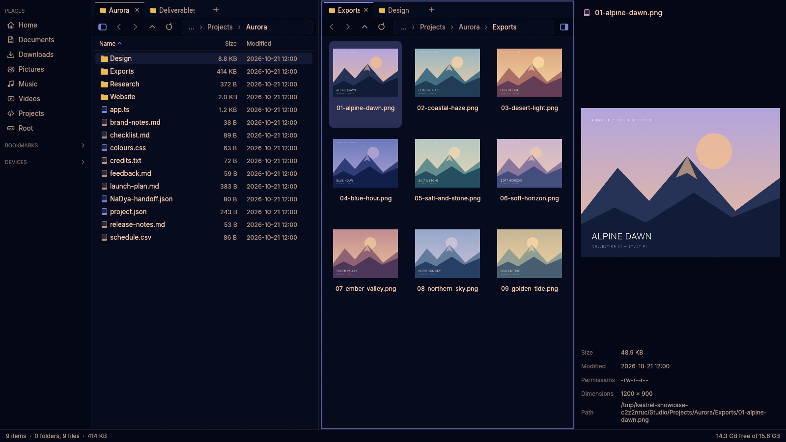
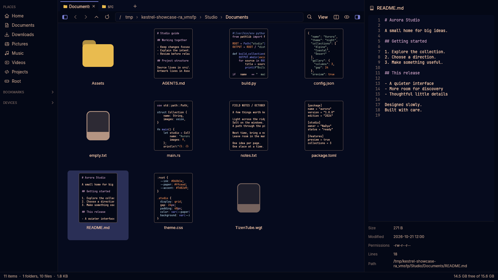
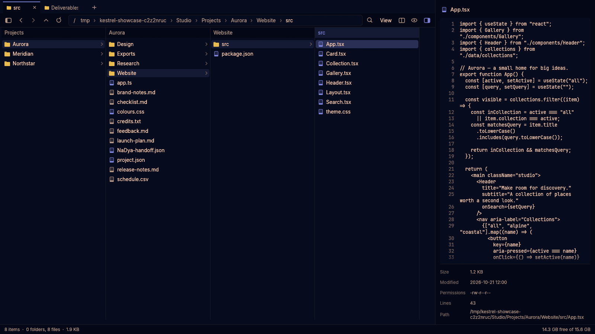
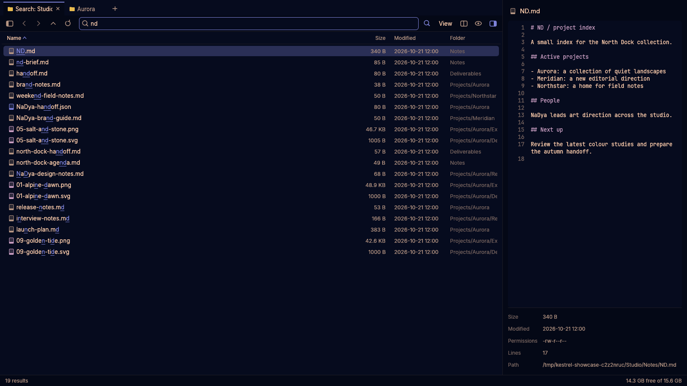
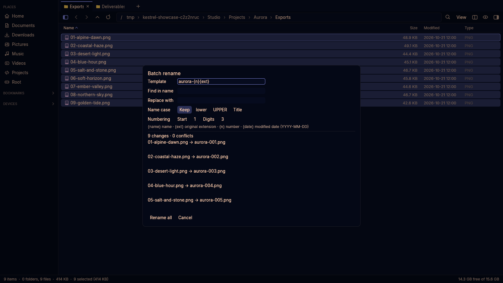

<p align="center">
  
</p>

<h1 align="center">Kestrel</h1>

<p align="center">
  A fast, keyboard-friendly file manager for <a href="https://omarchy.org">Omarchy</a>, inspired by <a href="https://filepilot.tech">File Pilot</a>.
</p>

<p align="center">
  Tabs, split panes, Miller columns, fuzzy search, and previews — in your desktop's colors.
</p>

<p align="center">
  <a href="assets/screenshots/overview.png"></a>
</p>

<p align="center"><sub>Real app captures with fictional studio projects, original sample artwork, and the active Omarchy theme. Click any screenshot to see it at full size.</sub></p>

## Install

```sh
curl -fsSL https://raw.githubusercontent.com/vanyapoker/kestrel/master/install.sh | bash
```

Open **Kestrel** from the app launcher (Super + Space), or run `kestrel` in a terminal.
Pass a folder to open it directly: `kestrel ~/Downloads`.

The installer sets up missing build tools, compiles Kestrel, and installs its launcher,
icon, update command, and file-dialog backend. The first build takes a few minutes.

## Browse with context

Switch between **Details**, **List**, **Icons**, and **Miller columns** from the View menu,
which shows the available keyboard shortcuts. Tabs can be reordered or dragged between
split panes; drag the divider to resize them, or double-click it for equal widths.
Tab names stay complete when space allows and use an ellipsis when crowded.
Scroll long tab strips horizontally with the mouse wheel; hover a tab for its full path.
Up to 32 recently closed tabs or splits can be
reopened during the current window session, including through Go To.

Icons view shows miniature file contents for Markdown, source code, plain text,
configuration files, and extensionless text files. Syntax colors follow your theme,
and the preview scales with Ctrl+scroll. Empty, binary, and unreadable files keep
their type icons; image, PDF, SVG, and video thumbnails continue to show their contents.
Text thumbnails load in the background from a small file sample.

[](assets/screenshots/text-thumbnails.png)

In Miller columns, selecting a folder reveals its contents to the right. **Right** or
**Enter** enters that column; **Left** returns to its parent. Each column keeps its own
selection, filter, and scroll position. Preview and file operations follow the active column.

[](assets/screenshots/columns.png)

**Ctrl+K** opens Go To: fuzzy-search open tabs, bookmarks, recent folders, and standard
places. **Ctrl+Shift+T** reopens a closed tab or split. Save named layouts through
**Save current workspace** in the **Ctrl+P** command palette; use **Workspaces** to load
or delete them. Open tabs, view modes, pane sizes, and panel layout also survive restarts.

## Find the best match

Start typing to filter the current folder, or press **Ctrl+F** to search its subfolders.
Matching is case-insensitive and fuzzy: `nd` finds `NaDya`. Exact names, prefixes, and
substrings rank above scattered letters, with matched characters highlighted.

[](assets/screenshots/search.png)

| Query | Matches |
|---|---|
| `nd` | Names containing those letters in order, including `NaDya` |
| `annual report` | Names matching both terms |
| `ext:pdf,jpg` | PDF or JPG files |
| `type:folder` / `type:file` | Folders or files |
| `"annual report"` | A contiguous literal phrase |
| `=report.pdf` | An exact filename |

Recursive searches reuse their filename scan as you refine the query. **F5** rescans;
the best 20,000 matches are retained across the complete scan. **Ctrl+Shift+F** flattens
a folder and its descendants into one list, with relative parent paths. Search and
flattened results temporarily use Details when browsing in Miller columns; leaving
them restores columns.

## Preview and inspect

Press **Space** or **F3** to toggle previews without opening another app. Preview images,
syntax-highlighted code, text, PDFs, videos, SVGs, audio details, and CSV tables. Text
wraps to the panel width; JSON is formatted for reading without changing the file.
Select and copy text directly from previews, including table cells and file details.
Web links in text and CSV previews open in your browser; tables scroll horizontally
and keep their header visible.

Select a folder to inspect its contents inside the preview panel. Click through nested
folders and files, go back within the inspector, or open the inspected folder in the
main view. Your main selection stays in place while you inspect.

## Rename with a preview

Select several items and press **F2** to preview every new name before applying it.
Replace text, change name case, or combine `{name}`, `{ext}`, `{n}`, and `{date}` in a
template. Numbering supports a starting value and zero padding. Conflicts block applying;
**Ctrl+Z** undoes the batch as one operation.

[](assets/screenshots/batch-rename.png)

## More everyday tools

- **Folder sizes and sorting.** Folder sizes are calculated live. Sort by name, size,
  modified date, or type; click a Details header again to reverse the order. The status
  bar shows selection totals and free disk space.
- **Background work and live updates.** Folder listings, size calculations, searches,
  previews, and file operations run in the background. Listings refresh when files change.
- **Copy, move, and undo.** File operations show byte progress and can be cancelled
  from the status bar or command palette. Delete sends files to the trash;
  permanent deletion asks for confirmation. Existing destination names get numbered
  alternatives. Undo supports renames, moves, copies, new folders, and trashing.
- **Drag and drop.** Move files between panes or other apps; hold Ctrl to copy. Copy and
  paste files to and from other file managers, too.
- **Archives.** Extract beside the archive, into a folder named after it, or into the
  other split pane. Create zip, tar.gz, tar.xz, tar.zst, tar.bz2, or 7z archives through
  **Compress…**, with Fast, Normal, or Best compression; zip also supports Store.
  **Compress to .zip** is available as a quick action. Extraction also supports rar
  and other formats handled by `bsdtar`.
- **Efficient copies.** Copies use the kernel's `copy_file_range` where supported, with
  a streamed fallback. Copied files retain their permissions and modification times.
- **Drives.** Mount, unmount, and eject drives from the Devices section. Mounted
  drives show usage bars; device changes appear automatically.
- **Command palette.** **Ctrl+P** reaches every action, including creating an empty
  file, sorting, cancelling an operation, batch rename, and workspace management.
- **Paths and terminals.** **Ctrl+L** edits the current path, with Tab completion for
  folders. Copy a selected item's path with **Alt+C**, or open a terminal in the current
  folder with **Ctrl+Alt+T**.
- **Open with.** Choose an app from a file's context menu and set defaults for that file type.
- **Shared bookmarks.** GTK bookmarks also appear in Kestrel. Add folders through their
  context menu or drag them onto the sidebar's Bookmarks section.
- **Your Omarchy theme.** Colors follow the current light or dark theme and update live
  when you switch it.
- **Native file dialogs.** Kestrel can handle uploads and saves for apps using
  xdg-desktop-portal. See the setup notes below.

## Keyboard shortcuts

| Key | Action |
|---|---|
| <kbd>Ctrl</kbd>+<kbd>P</kbd> | Command palette |
| <kbd>Ctrl</kbd>+<kbd>K</kbd> | Go To: folders and open tabs |
| *start typing* | Filter the current folder (<kbd>Esc</kbd> clears) |
| <kbd>Ctrl</kbd>+<kbd>F</kbd> | Search subfolders |
| <kbd>Ctrl</kbd>+<kbd>Shift</kbd>+<kbd>F</kbd> | Toggle flattened folder view |
| <kbd>Enter</kbd> | Open |
| <kbd>Backspace</kbd> / <kbd>Alt</kbd>+<kbd>↑</kbd> | Go up a folder |
| <kbd>Alt</kbd>+<kbd>←</kbd> / <kbd>Alt</kbd>+<kbd>→</kbd>, Mouse 4 / 5 | Back / forward |
| <kbd>Alt</kbd>+<kbd>Home</kbd> | Go to the home folder |
| <kbd>Ctrl</kbd>+<kbd>L</kbd> | Type a path (<kbd>Tab</kbd> completes folder names) |
| <kbd>Ctrl</kbd>+<kbd>C</kbd> / <kbd>X</kbd> / <kbd>V</kbd> | Copy / cut / paste |
| <kbd>Ctrl</kbd>+<kbd>Z</kbd> | Undo (rename, move, copy, new folder, move to trash) |
| <kbd>Ctrl</kbd>+<kbd>D</kbd> | Duplicate |
| <kbd>Ctrl</kbd>+<kbd>A</kbd> / <kbd>Ctrl</kbd>+<kbd>Space</kbd> | Select all / toggle the current item |
| <kbd>F2</kbd> | Rename |
| <kbd>Ctrl</kbd>+<kbd>Shift</kbd>+<kbd>N</kbd> | New folder |
| <kbd>Delete</kbd> / <kbd>Shift</kbd>+<kbd>Delete</kbd> | Move to trash / delete permanently (confirm with <kbd>Enter</kbd>, cancel with <kbd>Esc</kbd> or <kbd>Backspace</kbd>) |
| <kbd>Alt</kbd>+<kbd>C</kbd> | Copy path |
| <kbd>Ctrl</kbd>+<kbd>Alt</kbd>+<kbd>T</kbd> | Open a terminal here |
| <kbd>Ctrl</kbd>+<kbd>T</kbd> / <kbd>Ctrl</kbd>+<kbd>W</kbd> | New / close tab |
| <kbd>Ctrl</kbd>+<kbd>Shift</kbd>+<kbd>T</kbd> | Reopen closed tab or split |
| <kbd>Ctrl</kbd>+<kbd>Tab</kbd> / <kbd>Ctrl</kbd>+<kbd>Shift</kbd>+<kbd>Tab</kbd> | Next / previous tab |
| <kbd>Ctrl</kbd>+<kbd>1</kbd>…<kbd>9</kbd> | Switch to a tab by position |
| <kbd>F6</kbd> or <kbd>Ctrl</kbd>+<kbd>\\</kbd> | Split view (<kbd>Tab</kbd> switches pane) |
| <kbd>Ctrl</kbd>+<kbd>G</kbd> | Icons / details view |
| <kbd>Ctrl</kbd>+<kbd>Shift</kbd>+<kbd>M</kbd> | Toggle Miller columns |
| <kbd>←</kbd> / <kbd>→</kbd> | Parent / child column (in Miller columns; outside text fields) |
| <kbd>Ctrl</kbd>+scroll | Zoom through Details, List and icon sizes (outside Miller columns) |
| <kbd>Ctrl</kbd>+<kbd>H</kbd> | Show hidden files |
| <kbd>Space</kbd> / <kbd>F3</kbd> | Toggle preview panel (outside text fields) |
| <kbd>Ctrl</kbd>+<kbd>B</kbd> | Sidebar |
| <kbd>F5</kbd> | Refresh |

Use <kbd>Shift</kbd> with the arrow keys or Ctrl/Shift+click to select several items.
Hold <kbd>Ctrl</kbd> while dragging to copy instead of move. Middle-click a folder
to open it in a new tab. Navigation shortcuts leave text-field cursor movement intact.

## Setup notes

- **Update:** run `kestrel-update`. This pulls the latest source and rebuilds it.
  Running the install command again does the same thing.
- **Default file manager:** run `xdg-mime default kestrel.desktop inode/directory`.
- **Preview helpers:** Omarchy includes these already. On other systems, install
  `poppler ffmpeg librsvg wl-clipboard` for PDF/video/SVG previews and clipboard support.
- **Firefox file dialogs:** set `widget.use-xdg-desktop-portal.file-picker` to `1` in
  `about:config`. The installer registers Kestrel's portal backend; if a portal preference
  file already exists, follow the installer's instructions to select Kestrel.
- **Archive and drive helpers:** archives use `bsdtar` from libarchive; drive
  operations use `udisksctl` from udisks2.
- **Picker window rules:** the file-dialog window class is `kestrel-picker`.
- **Try a different theme for Kestrel:** use
  `KESTREL_OMARCHY_THEME=/usr/share/omarchy/themes/gruvbox kestrel` without changing
  your desktop theme.

### Use Kestrel from scripts

The file picker can also run directly from a shell, without a portal integration:

```sh
kestrel --pick open --multiple --dir ~/Pictures --title "Choose images"
kestrel --pick folder --dir ~/Projects
kestrel --pick save --dir ~/Documents --name report.md
```

It prints selected paths to standard output, one per line, and prints nothing when
cancelled. Open and folder pickers accept `--multiple`; all three modes accept
`--title` and `--dir`, and Save accepts a suggested filename through `--name`.
Picker windows use a temporary session and leave your regular layout unchanged.

### Uninstall

```sh
bash ~/.local/share/kestrel/source/install.sh --uninstall
```

If you installed from your own clone, run `./install.sh --uninstall` there instead.

## Building from source

```sh
git clone https://github.com/vanyapoker/kestrel.git
cd kestrel
./install.sh          # build and install this checkout
cargo run --release   # or run without installing
cargo test --locked
```

Kestrel is written in Rust with [egui](https://github.com/emilk/egui). It ships a lightly
patched `egui-winit` (see [the patch notes](vendor/egui-winit/KESTREL_PATCHES.md)) so drag
and drop works on Hyprland.

### Recreating the screenshots

```sh
python3 scripts/screenshots.py
# Or refresh just the document-thumbnail scene:
python3 scripts/screenshots.py --only text-thumbnails
```

Requires Cargo, Xvfb, ImageMagick, librsvg, and libXtst. The script builds this checkout,
generates fictional projects and original SVG/PNG artwork, and drives the actual app
on an isolated display. It uses the active Omarchy theme, saves captures under
`assets/screenshots/`, and cleans up its temporary files. Your desktop theme, personal
files, and saved Kestrel session stay unchanged. Set `KESTREL_OMARCHY_THEME` to capture
a different theme.

## License

[MIT](LICENSE)
